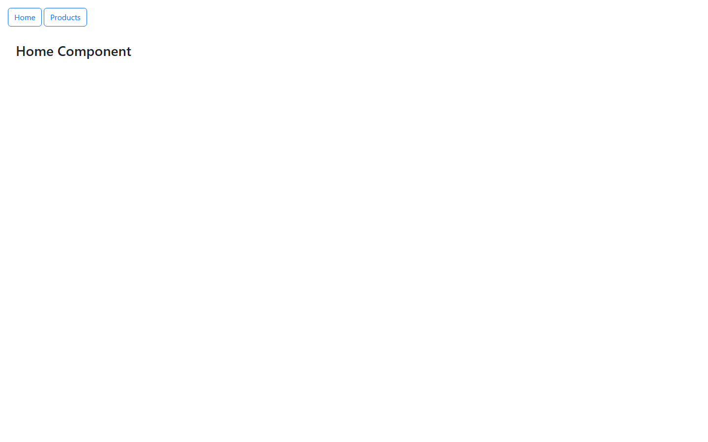
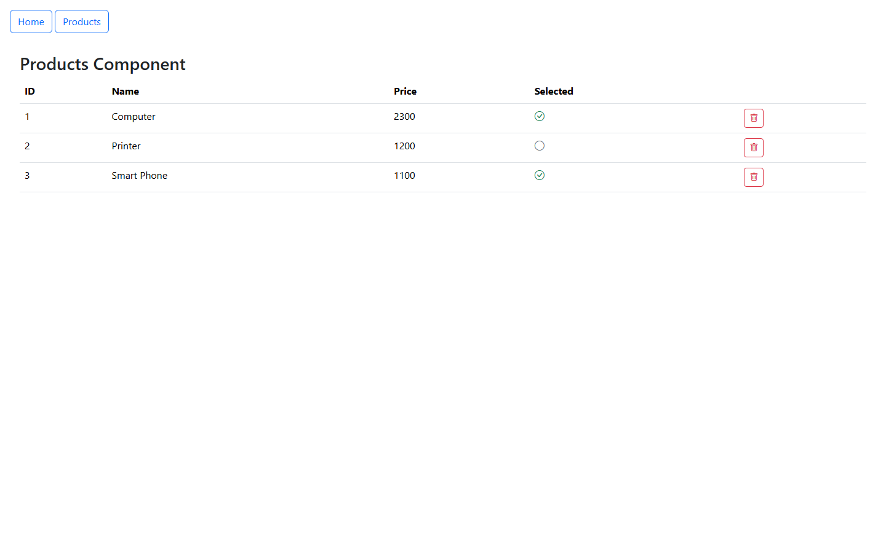

# EmsiApp (`emsi-app`)

> A small standalone Angular 21 application built as part of the ENSIAS JEE practical work (`tp-jee`). It uses Bootstrap 5 for styling, Angular's built-in control flow and router for two simple screens, and an injectable in-memory service that holds a hardcoded product list with a delete action.

The application is entirely client-side: there is no backend, no HTTP client and no persistent storage. It was generated with Angular CLI 21.2.30 and extended commit by commit with navbar routing, a Home page and a Products table.

---

## Table of contents

- [Overview](#overview)
- [Tech stack](#tech-stack)
- [Pages and routes](#pages-and-routes)
- [Screenshots](#screenshots)
- [Prerequisites](#prerequisites)
- [Getting started](#getting-started)
- [Application structure](#application-structure)
- [Products service](#products-service)
- [Testing](#testing)
- [Build](#build)
- [Limitations](#limitations)
- [Possible improvements](#possible-improvements)
- [Git history](#git-history)

---

## Overview

`emsi-app` is the simplest of the `tp-jee` demo applications. It demonstrates:

- standalone Angular components bootstrapped with `bootstrapApplication` (no NgModules),
- client-side routing with two routes and an empty-path redirect,
- Bootstrap 5 buttons, tables, spacing utilities and Bootstrap Icons,
- Angular's built-in `@if` / `@for` control flow (no `*ngIf` / `*ngFor`),
- dependency injection of a root-provided service holding in-memory data,
- a deletion flow using a native browser `confirm()` dialog.

```
Browser (localhost:4200)
 └── App shell (navbar: Home | Products)
      ├── /home  → static "Home Component" text
      └── /prods → product table fed by the in-memory Product service
```

---

## Tech stack

| Technology | Version / usage |
|---|---|
| Angular | 21.2.x (`@angular/core` 21.2.26, CLI 21.2.30), standalone components |
| TypeScript | 5.9.x, strict mode enabled |
| Bootstrap | 5.3.9 (CSS only, imported globally) |
| Bootstrap Icons | 1.13.2 (check/circle/trash icons) |
| RxJS | 7.8.2 (installed, not used by application code) |
| Vitest + jsdom | 4.1.12 / 28.1.0 via `@angular/build:unit-test` |
| Prettier | 3.10.1 (single quotes, 100-char lines) |

No backend framework, database, authentication, HTTP client, signals, forms or state-management library is used.

---

## Pages and routes

Routes are declared in `src/app/app.routes.ts`:

| Route | Component | Content |
|---|---|---|
| `/` | — | Redirects to `/home` (`pathMatch: 'full'`) |
| `/home` | `Home` | Heading **"Home Component"** inside a Bootstrap card body |
| `/prods` | `Products` | Table of products with ID, Name, Price, Selected status and a delete button per row |

Navigation is a pair of Bootstrap outline buttons in `app.component.html`:

- **Home** → `routerLink="/home"`
- **Products** → `routerLink="/prods"`

There is no active-link highlighting, no default page beyond the redirect, and no wildcard route.

The Products table shows three seeded items:

| ID | Name | Price | Selected |
|---|---|---|---|
| 1 | Computer | 2300 | ✔ |
| 2 | Printer | 1200 | ✘ |
| 3 | Smart Phone | 1100 | ✔ |

Clicking the trash icon opens a native `confirm("Are you sure you want to delete this product?")`. Accepting it removes the row from the service and refreshes the table. Removing all products shows an empty state: **"No products left."** Changes are lost on a full page reload because the service stores data in memory only.

---

## Screenshots

Screenshots were captured from the running application (`ng serve`, <http://localhost:4200>) and stored in [`docs/screenshots`](docs/screenshots).

### Home page (`/home`)



### Products page with seeded data (`/prods`)



---

## Prerequisites

- Node.js 20+ and npm 10+ (Angular 21; lockfile declares `npm@10.9.3`)
- A Chromium-based browser for the screenshots/debug setup (optional)

Dependencies are already installed locally (`node_modules/`), but a fresh clone requires `npm install`.

---

## Getting started

```bash
npm install
npm start
```

Then open <http://localhost:4200/> — the root URL redirects to `/home`. Click **Products** to see the product table and try the delete buttons.

To take the screenshots again, run the app and capture `http://localhost:4200/home` and `http://localhost:4200/prods` at a 1440×900 viewport.

---

## Application structure

```text
emsi-app/
├── angular.json                  # CLI build/serve/test configuration
├── package.json                  # Angular 21 + Bootstrap dependencies
├── tsconfig*.json                # strict TypeScript configuration
├── public/
│   └── favicon.ico
├── src/
│   ├── index.html                # <app-root> host, title "EmsiApp"
│   ├── main.ts                   # bootstrapApplication(App, appConfig)
│   ├── styles.css                # global Bootstrap + Bootstrap Icons imports
│   └── app/
│       ├── app.ts / app.html     # root component and navbar (selector app-root)
│       ├── app.config.ts         # provideBrowserGlobalErrorListeners + provideRouter
│       ├── app.routes.ts         # '', /home, /prods
│       ├── app.spec.ts           # 2 Vitest tests
│       ├── home/                 # static Home page
│       ├── products/             # product table + delete interaction
│       └── services/product.ts   # ProductItem interface + in-memory Product service
└── docs/screenshots/             # real screenshots of the running app
```

Key files:

- `src/main.ts` uses `bootstrapApplication`, so there are **no NgModules** — every component is standalone.
- `src/app/app.config.ts` registers only `provideBrowserGlobalErrorListeners()` and `provideRouter(routes)`; notably there is **no `provideHttpClient()`**.
- `src/styles.css` contains only two `@import` lines for Bootstrap and Bootstrap Icons. All component CSS files are empty.
- `src/app/app.html` contains the entire navigation UI: two buttons and `<router-outlet>`.

---

## Products service

`src/app/services/product.ts` defines the `ProductItem` model and a root-provided `Product` service:

```ts
export interface ProductItem {
  id: number;
  name: string;
  price: number;
  selected: boolean;
}

@Injectable({ providedIn: 'root' })
export class Product {
  private products: ProductItem[] = [
    { id: 1, name: 'Computer', price: 2300, selected: true },
    { id: 2, name: 'Printer', price: 1200, selected: false },
    { id: 3, name: 'Smart Phone', price: 1100, selected: true }
  ];

  getAllProducts(): ProductItem[] { return this.products; }
  deleteProduct(product: ProductItem): void {
    this.products = this.products.filter((p) => p.id !== product.id);
  }
}
```

The `Products` component calls `getAllProducts()` in `ngOnInit()` and again after a confirmed deletion. The template uses `@if (products.length > 0)` / `@for (p of products; track p.id)` and shows a green check icon or a grey circle depending on `selected`.

---

## Testing

```bash
npm test
```

Vitest runs via the `@angular/build:unit-test` builder with jsdom. `src/app/app.spec.ts` contains two tests:

1. `should create the app` — the root component is instantiated.
2. `should render the navigation` — the shell renders exactly two `<nav>` buttons.

There are no tests for the Home or Products components, the service, or the delete interaction.

---

## Build

```bash
npm run build
```

The production build is written to `dist/emsi-app/browser/` with hashed filenames, inlined critical Bootstrap CSS, minified JavaScript (about 212 kB) and the Bootstrap icon fonts. `dist/`, `node_modules/` and `.angular/cache/` are gitignored.

A development watch build is available with `npm run watch`.

---

## Limitations

- Hardcoded, in-memory data: deletions disappear on page reload; there is no add/update operation.
- No backend integration — the app cannot fetch or persist real products.
- The `confirm()` dialog is a blocking native browser dialog and is not styled with Bootstrap.
- No active-link styling, no wildcard route (an unknown URL shows an empty shell).
- No environment files or API configuration; the router has no lazy-loaded routes.
- `@angular/forms` and RxJS are installed but unused.
- No Docker, CI/CD pipeline or deployment scripts.

---

## Possible improvements

- Connect the product service to an HTTP API using `provideHttpClient()` and `environment.ts` URLs.
- Add create/edit forms with reactive forms and validation.
- Replace `confirm()` with a Bootstrap modal for a consistent UI.
- Add active-link highlighting and a 404 wildcard route.
- Add tests for the Products component and the service's delete behaviour.
- Persist changes (localStorage or a backend) so deletions survive a reload.

---

## Git history

The repository has three linear commits, all by `rimjabal`:

| Commit | Description |
|---|---|
| `46125c7` | Initialize Angular project with Bootstrap dependencies |
| `9e87d23` | Add navbar routing and home component |
| `5bee163` | Add products table and product service with delete action |

Remote: <https://github.com/rimjabal/angular-app.git>
